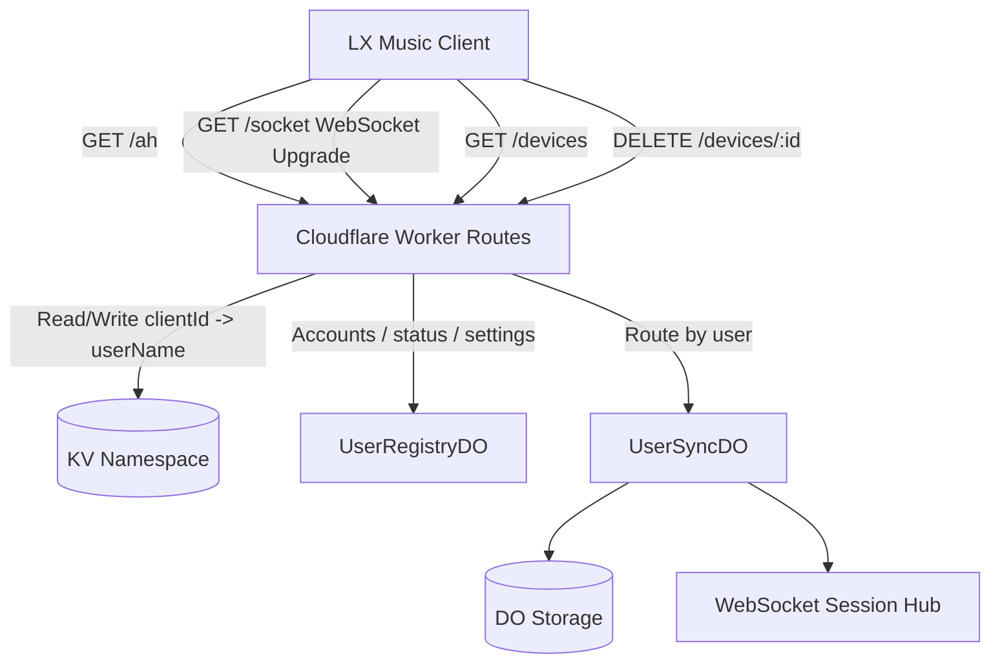

# lx-music-server

[](https://github.com/WorkerHub/lx-music-server/actions/workflows/deploy.yml)
[](LICENSE)
[](https://workers.cloudflare.com/)
[](https://pnpm.io/)

A Cloudflare Workers rewrite of [`lx-music-sync-server`](https://github.com/lyswhut/lx-music-sync-server), using Durable Objects for stateful WebSocket synchronization.

Built for one goal: run multi-device sync without self-hosting servers.

[English](README.en.md) ｜ [中文](README.md)

## Table of Contents

- [Why This Version](#why-this-version)
- [Deployment Guide](#deployment-guide)
- [Client Configuration](#client-configuration)
- [Admin Panel](#admin-panel)
- [Device Management API](#device-management-api)
- [Security Notes](#security-notes)
- [Local Development](#local-development)
- [Migration](#migration)
- [Architecture](#architecture)
- [FAQ](#faq)
- [License](#license)

## Why This Version

- Serverless operations on Cloudflare Workers + Durable Objects
- Strong user isolation with one DO instance per user
- Real-time two-way sync for playlists and dislike rules
- Snapshot-based incremental merge across multiple devices
- Fast rollout via GitHub Actions

## Deployment Guide

### 1. Create a Cloudflare KV Namespace

1. Log in to [Cloudflare Dashboard](https://dash.cloudflare.com/)
2. Go to **Workers & Pages -> KV**
3. Click **Create a namespace**
4. Enter a name (for example, `lx-music-kv`) and create it
5. Copy the **Namespace ID** from the namespace detail page

### 2. Create a Cloudflare API Token

1. Log in to [Cloudflare Dashboard](https://dash.cloudflare.com/)
2. Go to **My Profile -> API Tokens** (or visit https://dash.cloudflare.com/profile/api-tokens)
3. Click **Create Token**
4. Choose **Edit Cloudflare Workers** template
5. Make sure permissions include:
  - Account / Workers Scripts / Edit
  - Account / Workers KV Storage / Edit
  - Account / Durable Objects / Edit
6. (Optional) Restrict resources to one account
7. Create the token and save it securely (shown only once)

### 3. Configure GitHub Actions in your fork

In **Settings -> Secrets and variables -> Actions**, add:

Variables:

| Name | Description |
|---|---|
| `KV_NAMESPACE_ID` | KV namespace ID (**not a secret**, use a Variable) |

Secrets:

| Name | Description |
|---|---|
| `CLOUDFLARE_API_TOKEN` | API token from step 2 |
| `LX_USERS` | User config list (**required, non-empty**; first-boot seeding, see below) |
| `LX_ADMIN_PASSWORD_HASH` | SHA-256 of the admin panel password (**required**, see "Admin Panel") |

### 4. Configure users (`LX_USERS`, required / non-empty, first-boot seeding)

- **New deployment**: `LX_USERS` is **required (non-empty)**. Configure at least one user (either format); if it is missing or empty, the deployment fails.
- **Upgrading from an older version**: configure `LX_ADMIN_PASSWORD_HASH` (the SHA-256 of the admin panel password, **required**) **before** deploying the new version; if it is missing or malformed, the deployment fails.
- **After deploying the new version**: open `/admin` and confirm all of your existing users are present (the one-time import has completed), **then** delete the `LX_USERS` secret. From then on, add, remove or reset users in the admin panel.

The rest of this section documents the two `LX_USERS` formats and the security notes; you only need them for first-boot seeding, including upgrades from an older version.

`LX_USERS` is delivered as a **Secret** (uploaded by GitHub Actions via `wrangler deploy --secrets-file`, no longer written to `wrangler.toml` `[vars]`, so it does not show up in plaintext in the Cloudflare dashboard variables list). Two input formats are supported.

Simple format (comma-separated `username:password` pairs):

```text
admin:your_password,alice:her_password
```

JSON format (with extra options and password-hash support):

```json
[{"name":"admin","passwordHash":"5f4dcc3b5aa765d61d8327deb882cf99"},{"name":"alice","password":"her_password","maxSnapshotNum":30}]
```

Supported fields:

| Field | Type | Description |
|---|---|---|
| `name` | string | Username (required) |
| `password` | string | Plaintext password (mutually exclusive with `passwordHash`) |
| `passwordHash` | string | 32-char hex MD5 of the password (recommended, see Security Notes) |
| `maxSnapshotNum` | number | Max snapshot retention, default 20 |
| `list.addMusicLocationType` | `"top"` \| `"bottom"` | Song insert position, default `"bottom"` |

> **About `passwordHash`**: the auth protocol requires the server to hold `MD5(password)` in order to decrypt the client auth packet, so `passwordHash` must be an **unsalted MD5** (32 hex chars), not a salted hash. To generate it:
>
> ```bash
> # macOS / Linux
> printf 'your_password' | md5
> # or with Node
> node -e "console.log(require('crypto').createHash('md5').update('your_password').digest('hex'))"
> ```
>
> Storing `passwordHash` keeps the plaintext password out of the Cloudflare dashboard, but it is still a password-equivalent derived value — anyone who obtains it can authenticate and sync as that user. Either way, always use a strong random password.

`LX_USERS` is only imported into the registry on the **first deployment** (users land as `active` / `source=imported`); after that the registry is authoritative, so editing `LX_USERS` later does not touch existing users — add, remove or reset users in the admin panel. `LX_USERS` must be non-empty: if it is missing or empty, the deployment fails.

### 5. Trigger deployment

Open **Actions -> Deploy to Cloudflare Workers -> Run workflow**.

If you update Secrets, trigger deployment again manually.

### 6. Access URL

Default URL example:

```text
https://lx-music-server.<your-subdomain>.workers.dev
```

You can also bind a custom domain at `Settings -> Domains & Routes -> Custom Domain`.

Before migrating from another sync server, back up local client data first.

### 7. Auth and registration rate limiting

`/ah`, `/api/register` and `/api/admin/login` all apply built-in IP rate limiting (10 requests / 60 s by default) through the shared `RATE_LIMITER` binding in `wrangler.toml`. Each endpoint uses its own key (`<ip>`, `register:<ip>`, `admin:<ip>`), so one endpoint's traffic never consumes another's quota. The binding's `namespace_id` must be unique within your Cloudflare account: if another Worker already uses `1001`, change it to an unused positive integer.

> This limit is counted per Cloudflare location and is eventually consistent — enough to stop single-source brute force. For account-wide global limiting, add a Cloudflare WAF rate limiting rule on top.

## Client Configuration

In LX Music sync settings:

- Server URL: `https://<your-worker-name>.<your-subdomain>.workers.dev` (or custom domain)
- Password: password for that user

## Admin Panel

The panel lives at `https://<worker-url>/admin` and is fully separate from sync users.

1. Generate the SHA-256 of an admin password (16+ random characters recommended):

```bash
printf 'your_admin_password' | shasum -a 256
# or with Node
node -e "console.log(require('crypto').createHash('sha256').update('your_admin_password').digest('hex'))"
```

2. Put the 64-char hex digest into the GitHub Secret `LX_ADMIN_PASSWORD_HASH` and redeploy. **This secret is required: if it is missing (or is not a valid 64-char hex SHA-256), the deployment fails outright** — it never silently ships with the panel disabled.

> Note how the secret is deleted: removing the GitHub Secret and redeploying does **not** delete the secret already stored on the Worker (`wrangler deploy --secrets-file` only adds/updates). To rotate the admin password, just write the new hash and redeploy; to remove it entirely, run `pnpm wrangler secret delete LX_ADMIN_PASSWORD_HASH` (after that, deployments fail because the required secret is missing, and the panel is no longer available).

What the panel does:

- User list: name, status (`active` / `pending` / `disabled`), source (imported / self-registered / admin), creation time, device count, snapshot limit.
- Add users, edit snapshot limit and insert position, reset passwords. Resetting a password **removes all of that user's devices by default** (forcing re-pairing) — paired devices authenticate with their device key, so a password change alone does not revoke them; the confirmation copy spells this out.
- Delete account: account only, sync data is kept; the name is reserved and listed under "orphaned data" so nobody can register the same name and inherit the playlists.
- Orphaned data: inspect remaining list/dislike snapshot summaries, then either restore the account (recreate with the same name and reattach the data) or purge it (requires typing the full name; irreversible).
- Registration mode: `closed` / `open` / `approval` (default `approval`).
- Device management: list and delete individual devices via the existing `/devices` data and deletion path.

The self-registration page is `/register`; it first calls `GET /api/registration-info` to decide between the form and a "registration closed" notice. Passwords must be 8–128 characters; 8–15 characters are flagged as weak (16+ random characters recommended).

## Device Management API

All endpoints use Basic Auth (same user credentials as sync login).

List authorized devices:

```bash
curl -u <username>:<password> https://<worker-url>/devices
```

Revoke a device:

```bash
curl -u <username>:<password> -X DELETE https://<worker-url>/devices/<clientId>
```

## Security Notes

To stay fully compatible with existing LX Music clients, this server keeps the client's auth/sync protocol, which carries some protocol-level risks. Please be aware of them and mitigate accordingly:

- **Always use a strong random password**: the auth key is derived from `MD5(password)` (unsalted, single MD5, first 16 hex chars as the AES key), so weak passwords are easy to brute force offline. Use a sufficiently long random password (16+ chars recommended) and prefer `passwordHash` so plaintext is not stored.
- **Expose only to trusted networks**: auth and sync traffic is not fully authenticated/encrypted at the protocol level (sync messages are gzip-only, not encrypted with the device key). Bind a custom domain and restrict sources with Cloudflare Access / WAF, or use it only within a trusted network.
- **WebSocket auth token travels in the URL query**: clients connect via `/socket?i=...&t=...`, so the token ends up in browser history, proxy logs and error reports. This is inherent to the upstream protocol; the server keeps it for compatibility. Avoid visiting the full tokenized URL on untrusted/shared devices.
- **Device management API uses Basic Auth**: `/devices` uses the same username/password as sync; the password comparison is now constant-time, but you should still restrict its source (e.g. a WAF rule limiting IPs).
- **The admin panel is the highest-privilege entry point**: `/admin` can add/remove users, reset passwords and purge sync data. Use a dedicated strong random password (only its SHA-256 is stored, in `LX_ADMIN_PASSWORD_HASH`) and strongly consider adding a Cloudflare Access policy or WAF source restriction for `/admin` and `/api/admin/*`. Session cookies are `HttpOnly; Secure; SameSite=Strict` and last 7 days; rotating the admin password invalidates existing sessions immediately.
- **Self-registration risk**: `open` mode lets anyone create an account, while `approval` (the default) still needs an admin decision. If the server is public and registration is not needed, switch to `closed`; both registration and login are rate-limited per IP.
- **Deleting an account does not delete data**: sync data is kept and the name is reserved under "orphaned data" so a stranger cannot register it and inherit the playlists. Only an admin can restore the account or purge it after an explicit confirmation — check what is being removed before purging.

These risks all stem from the "do not change the client protocol" constraint; the real fixes (salted KDF, AEAD encryption, token via first message) need client cooperation and are intentionally out of scope for server-only changes.

## Local Development

```bash
pnpm install
pnpm dev
```

`LX_USERS` is now a Secret, so for local development create a `.dev.vars` file (already git-ignored) with this content (note: this is the **file content**, not a shell command):

```text
LX_USERS='[{"name":"admin","password":"your_password"}]'
LX_ADMIN_PASSWORD_HASH='<64-char SHA-256 of the admin password>'
```

`LX_USERS` is required (non-empty) and only used for first-boot seeding; `LX_ADMIN_PASSWORD_HASH` is required — the deploy workflow fails when it is missing or malformed (locally under `pnpm dev`, leaving it out makes the panel and `/api/admin/*` return 404).

`wrangler types` is integrated in scripts, so type definitions are generated before dev/deploy.

Run tests:

```bash
pnpm test
```

Manual deploy:

```bash
pnpm deploy
```

## Migration

This security hardening round changed some configuration and deployment behavior. When upgrading from an older version:

1. **`LX_USERS` moved from `[vars]` to a Secret (required in older versions, required now)**: deployment no longer writes passwords into `wrangler.toml`; GitHub Actions now uploads them via `wrangler deploy --secrets-file`. The current version requires it (non-empty); if you are upgrading from an older version and want to keep your existing accounts, set the secret first and then re-run the deployment. For local development, use the `.dev.vars` file above.
2. **(Optional) migrate plaintext passwords to `passwordHash`**: replace `password` with `passwordHash` (32-char hex MD5) in `LX_USERS` so plaintext no longer appears in config. See "Configure users" for how to generate it. Both plaintext `password` and `passwordHash` remain supported.
3. **New `RATE_LIMITER` binding**: `wrangler.toml` now declares the auth rate-limiting binding; its `namespace_id` must be unique in your account — change it before deploying if it collides with an existing Worker.
4. **`SERVER_NAME` stays in `[vars]`**: this non-sensitive display name remains in `wrangler.toml` `[vars]` and can be viewed/edited in the dashboard.
5. **User registry moved to a Registry DO**: a new `UserRegistryDO` plus the `v2` migration (applied automatically on deploy). On first boot the users in `LX_USERS` are imported once (`active` / `source=imported`); afterwards the registry is the only source of truth. `LX_USERS` is required (non-empty) in both older and current versions (first-boot seeding only): an empty value makes the deployment fail. Existing clients need no change: `/ah`, `/socket` and `/devices` keep their protocol and responses.
6. **`LX_ADMIN_PASSWORD_HASH` is a required secret**: it enables the `/admin` panel. The deploy workflow validates it as a 64-char hex SHA-256 digest and fails outright when it is missing or malformed. When upgrading from an older version, generate and set the secret before triggering a deployment.

## Architecture



Key dependencies:

| Dependency | Purpose |
|---|---|
| [Hono](https://hono.dev) | HTTP routing framework |
| [message2call](https://github.com/lyswhut/message2call) | WebSocket RPC |
| [aes-js](https://github.com/ricmoo/aes-js) | AES encryption |
| [@noble/hashes](https://github.com/paulmillr/noble-hashes) | Hash implementation |

## FAQ

### 1. Deployment failed. What should I check first?

Check GitHub Actions config placement first:

- `KV_NAMESPACE_ID` goes in **Variables** (it is not a secret); `CLOUDFLARE_API_TOKEN`, `LX_ADMIN_PASSWORD_HASH` and `LX_USERS` go in **Secrets** (`LX_USERS` is required and non-empty)

If Variables and Secrets are mixed up, deployment will fail.

### 2. I changed `LX_USERS`, but users did not update. Why?

`LX_USERS` is only imported into the registry on first deployment; it no longer participates in auth. Use the `/admin` panel (requires `LX_ADMIN_PASSWORD_HASH`) to add/remove users or reset passwords.

### 3. Deployment succeeded but client cannot connect. What to check first?

Check these first:

- Worker URL in client settings
- Username/password matching an account in the admin panel
- `KV_NAMESPACE_ID` matches the correct Cloudflare account

### 4. Can I use only the default `workers.dev` domain?

Yes. Custom domain is optional.

### 5. Any migration advice from old sync servers?

Back up local data before switching server URL.

## License

[MIT](LICENSE)