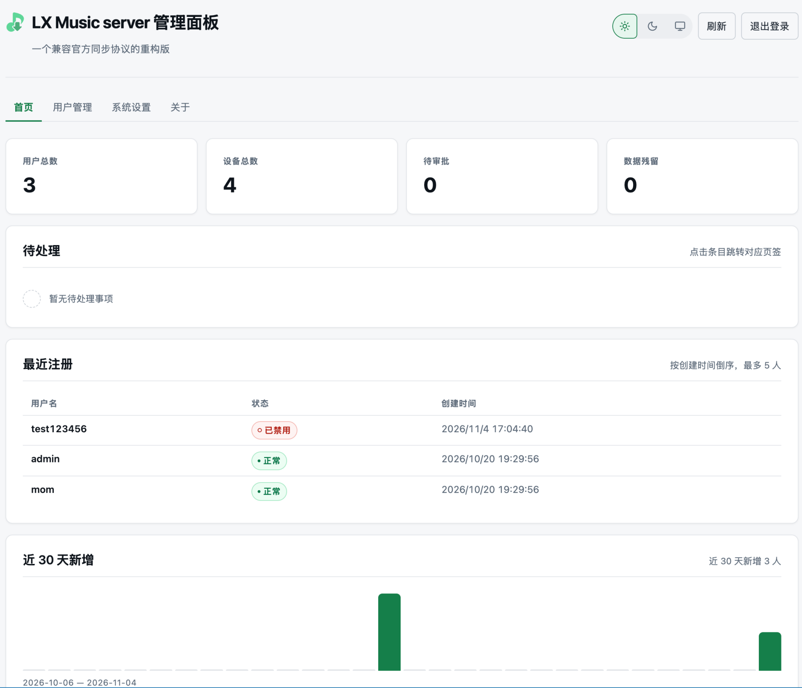
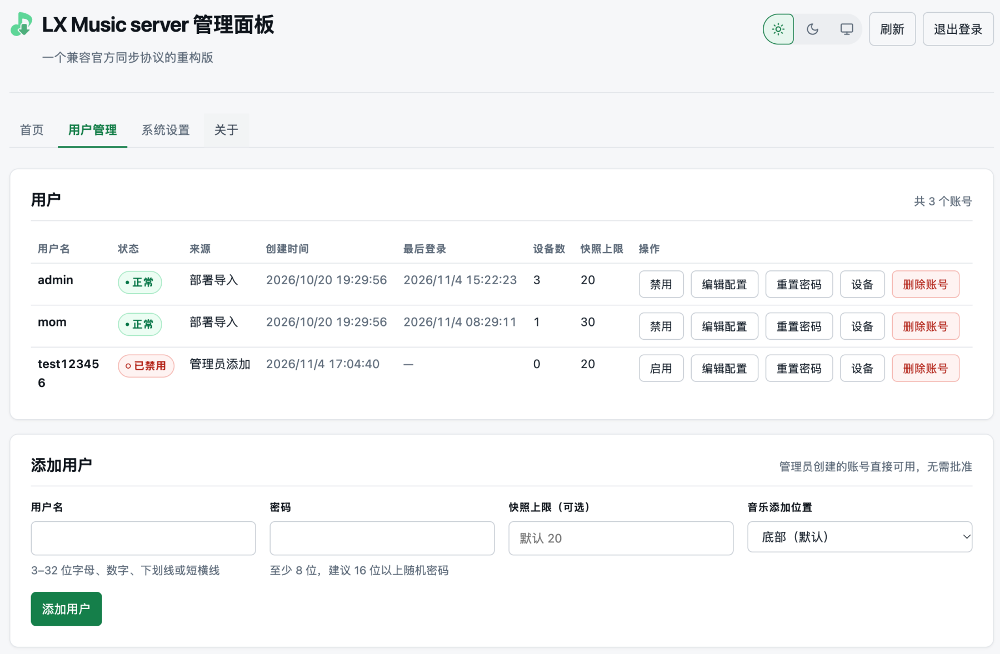
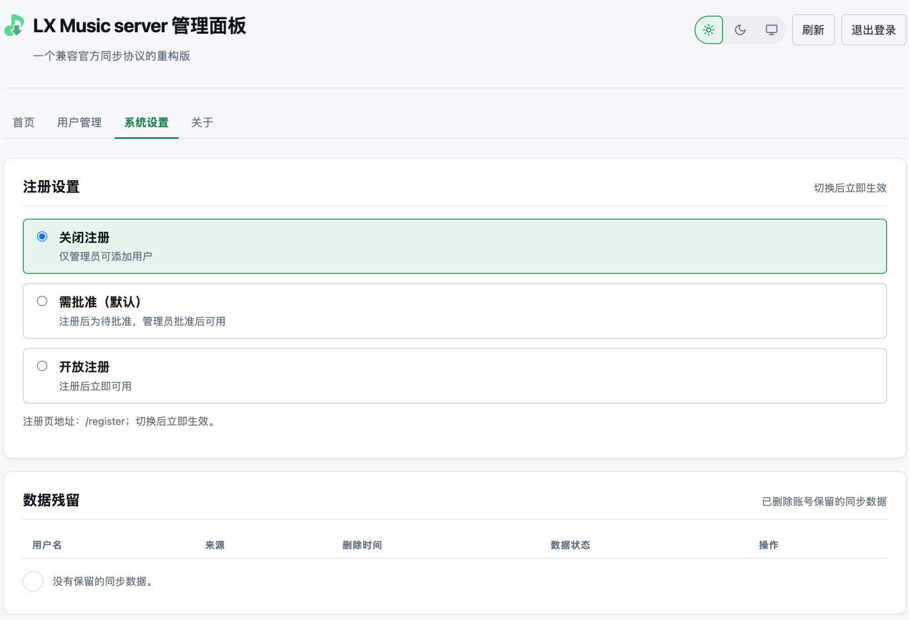
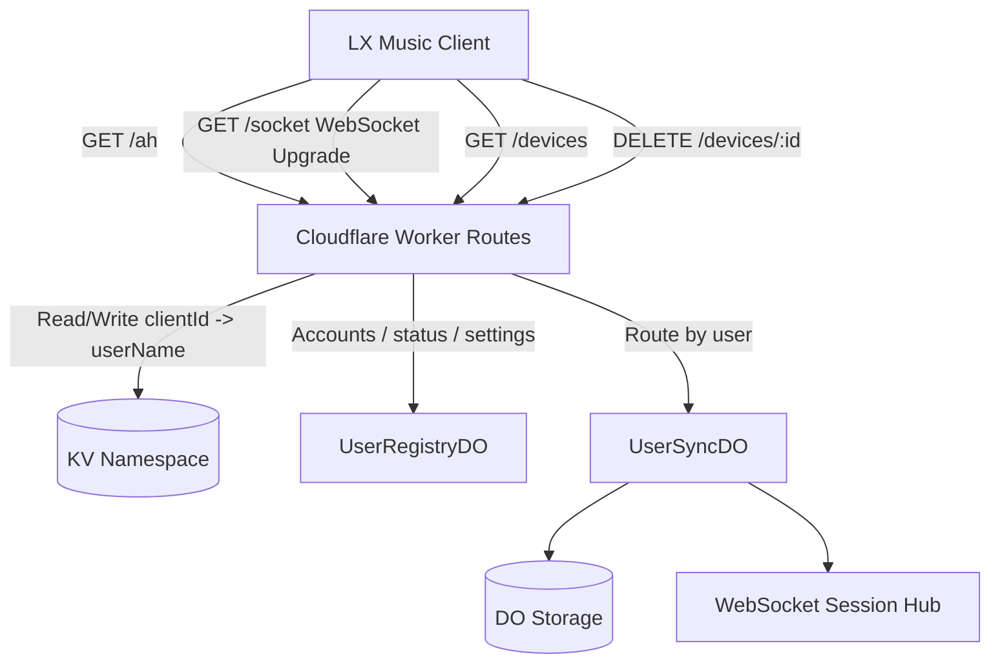

# lx-music-server

[](https://github.com/WorkerHub/lx-music-server/actions/workflows/deploy.yml)
[](LICENSE)
[](https://workers.cloudflare.com/)
[](https://pnpm.io/)

A Cloudflare Workers rewrite of [`lx-music-sync-server`](https://github.com/lyswhut/lx-music-sync-server), using Durable Objects for stateful WebSocket synchronization.

Built for one goal: run multi-device sync without self-hosting servers.

[English](README.en.md) ｜ [中文](README.md)

## Table of Contents

- [Preview](#preview)
- [Why This Version](#why-this-version)
- [Deployment Guide](#deployment-guide)
- [Client Configuration](#client-configuration)
- [Admin Panel](#admin-panel)
- [Device Management API](#device-management-api)
- [Security Notes](#security-notes)
- [Local Development](#local-development)
- [Migration](#migration)
- [Architecture](#architecture)
- [FAQ](#faq)
- [License](#license)


## Preview

Three main screens: the dashboard, user management and settings.

<p align="center">
  <br>
  <sub><b>Home</b>: user and device totals, pending items and recent sign-ups</sub>
</p>

<p align="center">
  
  <br>
  <sub><b>User management</b>: account status, devices, snapshot limit and actions · <b>Settings</b>: registration mode and global switches</sub>
</p>

## Why This Version

- Serverless operations on Cloudflare Workers + Durable Objects
- Strong user isolation with one DO instance per user
- Real-time two-way sync for playlists and dislike rules
- Snapshot-based incremental merge across multiple devices
- Fast rollout via GitHub Actions

## Deployment Guide

### 1. Create a Cloudflare KV Namespace

1. Log in to [Cloudflare Dashboard](https://dash.cloudflare.com/)
2. Go to **Workers & Pages -> KV**
3. Click **Create a namespace**
4. Enter a name (for example, `lx-music-kv`) and create it
5. Copy the **Namespace ID** from the namespace detail page

### 2. Create a Cloudflare API Token

1. Log in to [Cloudflare Dashboard](https://dash.cloudflare.com/)
2. Go to **My Profile -> API Tokens** (or visit https://dash.cloudflare.com/profile/api-tokens)
3. Click **Create Token**
4. Choose **Edit Cloudflare Workers** template
5. Make sure permissions include:
  - Account / Workers Scripts / Edit
  - Account / Workers KV Storage / Edit
  - Account / Durable Objects / Edit
6. (Optional) Restrict resources to one account
7. Create the token and save it securely (shown only once)

### 3. Configure GitHub Actions in your fork

In **Settings -> Secrets and variables -> Actions**, add these Secrets (all three belong under Secrets, not Variables):

| Name | Description |
|---|---|
| `KV_NAMESPACE_ID` | KV namespace ID from step 1 (GitHub masks it in logs) |
| `CLOUDFLARE_API_TOKEN` | API token from step 2 |
| `LX_ADMIN_PASSWORD_HASH` | **Required**: SHA-256 of the admin panel password — see the next step |

> `LX_USERS` is a legacy config from older versions and **a fresh install does not need it**; if you had it configured, follow [Migration](#migration) after upgrading to verify the users were imported and then delete it.

### 4. Set the admin password (`LX_ADMIN_PASSWORD_HASH`, required)

`LX_ADMIN_PASSWORD_HASH` is the login password of the `/admin` panel and **must be configured**: the deploy workflow fails outright without it. Sync accounts are created in that panel — with no panel, `/admin` and `/api/admin/*` return 404, self-registration defaults to requiring admin approval, and the service has no usable account at all.

Generate it (16+ random characters recommended):

```bash
printf 'your_admin_password' | shasum -a 256
# or with Node
node -e "console.log(require('crypto').createHash('sha256').update('your_admin_password').digest('hex'))"
```

Put the 64-char hex digest into the GitHub Secret `LX_ADMIN_PASSWORD_HASH`. The server stores only this SHA-256, never the plaintext; the deploy workflow requires it to be present and valid 64-char hex, so a missing or malformed value fails the deployment outright.

The admin password is independent of sync users: it never syncs and never occupies a sync username.

### 5. Trigger deployment

Open **Actions -> Deploy to Cloudflare Workers -> Run workflow**.

If you update Secrets, trigger deployment again manually.

### 6. Access URL

Default URL example:

```text
https://lx-music-server.<your-subdomain>.workers.dev
```

You can also bind a custom domain at `Settings -> Domains & Routes -> Custom Domain`.

Before migrating from another sync server, back up local client data first.

### 7. Create sync users in the admin panel

1. Open `https://<worker-url>/admin` and sign in with the admin password from step 4.
2. Click "Add user" and fill in a username and password — this is the sync account the client will use.
3. Enter the server URL and that account in the LX Music client and start syncing.

Adding users, resetting passwords, removing devices and switching the registration mode all happen in the same panel; see [Admin Panel](#admin-panel).

### 8. Auth and registration rate limiting

`/ah`, `/api/register` and `/api/admin/login` all apply built-in IP rate limiting (10 requests / 60 s by default) through the shared `RATE_LIMITER` binding in `wrangler.toml`. Each endpoint uses its own key (`<ip>`, `register:<ip>`, `admin:<ip>`), so one endpoint's traffic never consumes another's quota. The binding's `namespace_id` must be unique within your Cloudflare account: if another Worker already uses `1001`, change it to an unused positive integer.

> This limit is counted per Cloudflare location and is eventually consistent — enough to stop single-source brute force. For account-wide global limiting, add a Cloudflare WAF rate limiting rule on top.

## Client Configuration

In LX Music sync settings:

- Server URL: `https://<your-worker-name>.<your-subdomain>.workers.dev` (or custom domain)
- Password: password for that user

## Admin Panel

The panel lives at `https://<worker-url>/admin` and is fully separate from sync users. Sign in with the admin password whose SHA-256 you set as `LX_ADMIN_PASSWORD_HASH` (see step 4 of the deployment guide). The deploy workflow requires it: a deployment without it fails outright, and under local `pnpm dev` the panel and `/api/admin/*` return 404.

> Rotating the admin password: write the new SHA-256 into the GitHub Secret `LX_ADMIN_PASSWORD_HASH` and redeploy — existing sessions stop working immediately.
>
> Disabling the panel takes both steps, neither alone is enough: delete this Secret in the GitHub repo (every CI deployment then fails), then run `pnpm wrangler secret delete LX_ADMIN_PASSWORD_HASH`. Deleting only the GitHub Secret leaves the old value on the Worker, so the panel keeps working; running only `wrangler secret delete` makes the panel return 404 right away, but the next CI deployment writes the GitHub Secret's value back (`wrangler deploy --secrets-file` only adds/updates) and the panel returns with it. After both steps, no CI deployment is possible until the Secret is configured again.

What the panel does:

- User list: name, status (`active` / `pending` / `disabled`), source (imported / self-registered / admin), creation time, device count, snapshot limit.
- Add users, edit snapshot limit and insert position, reset passwords. Resetting a password **removes all of that user's devices by default** (forcing re-pairing) — paired devices authenticate with their device key, so a password change alone does not revoke them; the confirmation copy spells this out.
- Delete account: account only, sync data is kept; the name is reserved and listed under "orphaned data" so nobody can register the same name and inherit the playlists.
- Orphaned data: inspect remaining list/dislike snapshot summaries, then either restore the account (recreate with the same name and reattach the data) or purge it (requires typing the full name; irreversible).
- Registration mode: `closed` / `open` / `approval` (default `approval`).
- Device management: list and delete individual devices via the existing `/devices` data and deletion path.

The self-registration page is `/register`; registered passwords must be 8–128 characters, and 8–15 characters are flagged as weak (16+ random characters recommended).

## Device Management API

All endpoints use Basic Auth (same user credentials as sync login).

List authorized devices:

```bash
curl -u <username>:<password> https://<worker-url>/devices
```

Revoke a device:

```bash
curl -u <username>:<password> -X DELETE https://<worker-url>/devices/<clientId>
```

## Security Notes

To stay fully compatible with existing LX Music clients, this server keeps the client's auth/sync protocol, which carries some protocol-level risks. Please be aware of them and mitigate accordingly:

- **Always use a strong random password**: the auth key is derived from `MD5(password)` (unsalted, single MD5, first 16 hex chars as the AES key), so weak passwords are easy to brute force offline. Use a sufficiently long random password (16+ chars recommended) and prefer `passwordHash` so plaintext is not stored.
- **Expose only to trusted networks**: auth and sync traffic is not fully authenticated/encrypted at the protocol level (sync messages are gzip-only, not encrypted with the device key). Bind a custom domain and restrict sources with Cloudflare Access / WAF, or use it only within a trusted network.
- **WebSocket auth token travels in the URL query**: clients connect via `/socket?i=...&t=...`, so the token ends up in browser history, proxy logs and error reports. This is inherent to the upstream protocol; the server keeps it for compatibility. Avoid visiting the full tokenized URL on untrusted/shared devices.
- **Device management API uses Basic Auth**: `/devices` uses the same username/password as sync; the password comparison is now constant-time, but you should still restrict its source (e.g. a WAF rule limiting IPs).
- **The admin panel is the highest-privilege entry point**: `/admin` can add/remove users, reset passwords and purge sync data. Use a dedicated strong random password (only its SHA-256 is stored, in `LX_ADMIN_PASSWORD_HASH`) and strongly consider adding a Cloudflare Access policy or WAF source restriction for `/admin` and `/api/admin/*`. Session cookies are `HttpOnly; Secure; SameSite=Strict` and last 7 days; rotating the admin password invalidates existing sessions immediately.
- **Self-registration risk**: `open` mode lets anyone create an account, while `approval` (the default) still needs an admin decision. If the server is public and registration is not needed, switch to `closed`; both registration and login are rate-limited per IP.
- **Deleting an account does not delete data**: sync data is kept and the name is reserved under "orphaned data" so a stranger cannot register it and inherit the playlists. Only an admin can restore the account or purge it after an explicit confirmation — check what is being removed before purging.

These risks all stem from the "do not change the client protocol" constraint; the real fixes (salted KDF, AEAD encryption, token via first message) need client cooperation and are intentionally out of scope for server-only changes.

## Local Development

```bash
pnpm install
pnpm dev
```

Create a `.dev.vars` file (already git-ignored) containing the SHA-256 of the admin password (note: this is the **file content**, not a shell command):

```text
LX_ADMIN_PASSWORD_HASH='<64-char SHA-256 of the admin password>'
```

After `pnpm dev`, open `http://localhost:8787/admin`, sign in with that password and add a test user. Secret values are never written to `wrangler.toml`; without `LX_ADMIN_PASSWORD_HASH` the panel and `/api/admin/*` return 404 (locally too), while a CI deployment requires the Secret to be present and valid 64-char hex or fails outright.

`LX_USERS` is a one-time seeding source left over from older versions and is not needed for local development; add `LX_USERS='[{"name":"admin","password":"your_password"}]'` only when reproducing an upgrade (it must be a valid JSON array; see the appendix under Migration).

`wrangler types` is integrated in scripts, so type definitions are generated before dev/deploy.

Run tests:

```bash
pnpm test
```

Manual deploy:

```bash
pnpm deploy
```

## Migration

This security hardening round changed some configuration and deployment behavior. When upgrading from an older version:

1. **`LX_USERS` is legacy config from older versions — delete it after upgrading**: older versions declared users in the deployment config; the current version ships it as a Secret and imports it once on the registry's first boot (`active` / `source=imported`), after which the registry is authoritative and it no longer takes part in auth. If you had it configured: deploy the new version with the secret in place → confirm the old users are in `/admin` → delete the `LX_USERS` secret from the GitHub repo, then run `pnpm wrangler secret delete LX_USERS` (or delete it in the Cloudflare dashboard) to clear the value already on the Worker (deleting the GitHub secret alone leaves it there). **A fresh install does not need it.**
2. **(Optional) migrate plaintext passwords to `passwordHash`**: replace `password` with `passwordHash` (32-char hex MD5) in `LX_USERS` so plaintext no longer appears in config. See the appendix below for how to generate it. Both plaintext `password` and `passwordHash` remain supported.
3. **New `RATE_LIMITER` binding**: `wrangler.toml` now declares the auth rate-limiting binding; its `namespace_id` must be unique in your account — change it before deploying if it collides with an existing Worker.
4. **`SERVER_NAME` stays in `[vars]`**: this non-sensitive display name remains in `wrangler.toml` `[vars]` and can be viewed/edited in the dashboard.
5. **User registry moved to a Registry DO**: a new `UserRegistryDO` plus the `v2` migration (applied automatically on deploy). Users are managed through the registry from then on (the legacy `LX_USERS` is imported once on first boot, see item 1). Existing clients need no change: `/ah`, `/socket` and `/devices` keep their protocol and responses.
6. **`LX_ADMIN_PASSWORD_HASH` is the admin panel password (required)**: the deploy workflow requires it to be present and valid 64-char hex SHA-256 — a missing or malformed value fails the deployment outright (under local `pnpm dev` the panel and `/api/admin/*` return 404 without it). Set it before deploying, for fresh installs and upgrades alike.

### Appendix: `LX_USERS` format (upgrades or local development only)

`LX_USERS` is delivered as a **Secret** (uploaded by GitHub Actions via `wrangler deploy --secrets-file`, no longer written to `wrangler.toml` `[vars]`, so it does not show up in plaintext in the Cloudflare dashboard variables list). Only the JSON array format is supported, and it must be a valid JSON array:

```json
[{"name":"admin","passwordHash":"5f4dcc3b5aa765d61d8327deb882cf99"},{"name":"alice","password":"her_password","maxSnapshotNum":30}]
```

Supported fields:

| Field | Type | Description |
|---|---|---|
| `name` | string | Username (required) |
| `password` | string | Plaintext password (mutually exclusive with `passwordHash`) |
| `passwordHash` | string | 32-char hex MD5 of the password (recommended, see [Security Notes](#security-notes)) |
| `maxSnapshotNum` | number | Max snapshot retention, default 20 |
| `list.addMusicLocationType` | `"top"` \| `"bottom"` | Song insert position, default `"bottom"` |

> **About `passwordHash`**: the auth protocol requires the server to hold `MD5(password)` in order to decrypt the client auth packet, so `passwordHash` must be an **unsalted MD5** (32 hex chars), not a salted hash. To generate it:
>
> ```bash
> # macOS / Linux
> printf 'your_password' | md5
> # or with Node
> node -e "console.log(require('crypto').createHash('md5').update('your_password').digest('hex'))"
> ```
>
> Storing `passwordHash` keeps the plaintext password out of the Cloudflare dashboard, but it is still a password-equivalent derived value — anyone who obtains it can authenticate and sync as that user. Either way, always use a strong random password.

## Architecture



Key dependencies:

| Dependency | Purpose |
|---|---|
| [Hono](https://hono.dev) | HTTP routing framework |
| [message2call](https://github.com/lyswhut/message2call) | WebSocket RPC |
| [aes-js](https://github.com/ricmoo/aes-js) | AES encryption |
| [@noble/hashes](https://github.com/paulmillr/noble-hashes) | Hash implementation |

## FAQ

### 1. Deployment failed. What should I check first?

Check where the GitHub Actions items live: `KV_NAMESPACE_ID`, `CLOUDFLARE_API_TOKEN` and `LX_ADMIN_PASSWORD_HASH` all belong in **Secrets** (Secrets are masked in logs).

Under Variables the deploy workflow cannot read them: a missing `KV_NAMESPACE_ID` fails the deployment outright, and a missing admin password fails it too — there is no longer a deployment that succeeds without an admin panel. `LX_USERS` is legacy config from older versions; a fresh install does not need it (if set, it must be a valid JSON array).

### 2. I changed `LX_USERS`, but users did not update. Why?

`LX_USERS` is legacy config from older versions; a fresh install does not need it. It is imported into the registry once on first boot and no longer participates in auth afterwards. Use the `/admin` panel to add/remove users or reset passwords. If you upgraded from an older version, delete it once your users are imported.

### 3. Deployment succeeded but client cannot connect. What to check first?

Check these first:

- Worker URL in client settings
- Username/password matching an account in the admin panel
- `KV_NAMESPACE_ID` matches the correct Cloudflare account

### 4. Can I use only the default `workers.dev` domain?

Yes. Custom domain is optional.

### 5. Any migration advice from old sync servers?

Back up local data before switching server URL.

## License

[MIT](LICENSE)