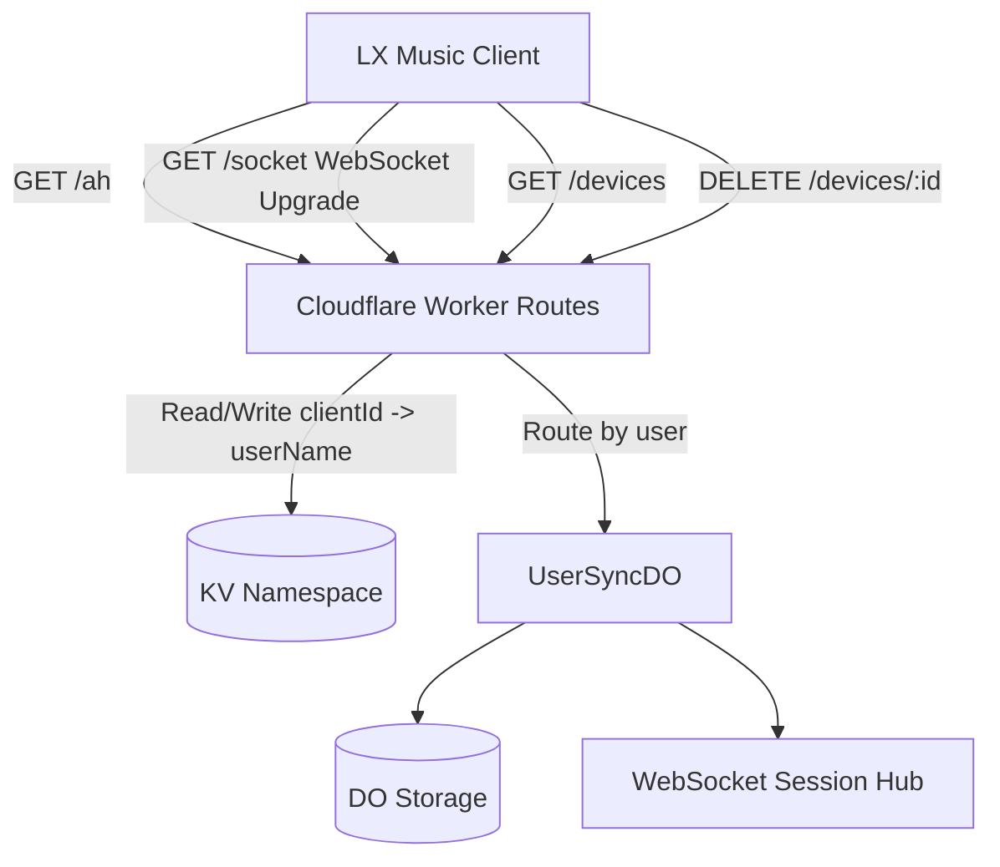

# lx-music-server

[](https://github.com/WorkerHub/lx-music-server/actions/workflows/deploy.yml)
[](LICENSE)
[](https://workers.cloudflare.com/)
[](https://pnpm.io/)

[`lx-music-sync-server`](https://github.com/lyswhut/lx-music-sync-server) 的 Cloudflare Workers 重构版，基于 Durable Objects 提供有状态 WebSocket 同步。

核心目标：不用自托管服务器，也能稳定做多设备实时同步。

[English](README.en.md) ｜ [中文](README.md)

## 目录

- [为什么选这个版本](#为什么选这个版本)
- [部署指南](#部署指南)
- [客户端配置](#客户端配置)
- [设备管理 API](#设备管理-api)
- [安全说明](#安全说明)
- [本地开发](#本地开发)
- [迁移说明](#迁移说明)
- [技术架构](#技术架构)
- [FAQ](#faq)
- [License](#license)

## 为什么选这个版本

- 无服务器运维：Cloudflare Workers + Durable Objects
- 多用户隔离：每个用户独立 DO 实例和存储
- WebSocket 实时同步：歌单和不喜欢规则双向同步
- 快照合并：支持多设备增量同步和冲突处理
- 一键部署：配合 GitHub Actions 可以快速上线

## 部署指南

### 1. 创建 Cloudflare KV Namespace

1. 登录 [Cloudflare Dashboard](https://dash.cloudflare.com/)
2. 进入 **Workers & Pages -> KV**
3. 点击 **Create a namespace**
4. 输入名称（如 `lx-music-kv`）并创建
5. 在详情页复制 **Namespace ID**

### 2. 创建 Cloudflare API Token

1. 登录 [Cloudflare Dashboard](https://dash.cloudflare.com/)
2. 进入 **My Profile -> API Tokens**（或访问 https://dash.cloudflare.com/profile/api-tokens）
3. 点击 **Create Token**
4. 选择 **Edit Cloudflare Workers** 模板
5. 确认权限至少包含：
  - Account / Workers Scripts / Edit
  - Account / Workers KV Storage / Edit
  - Account / Durable Objects / Edit
6. （可选）将账户范围限制到指定账号
7. 点击 **Create Token** 并复制保存（只显示一次）

### 3. Fork 后配置 GitHub Actions

在仓库 **Settings -> Secrets and variables -> Actions** 中添加：

Secrets：

| 名称 | 说明 |
|---|---|
| `CLOUDFLARE_API_TOKEN` | 上一步创建的 API Token |
| `KV_NAMESPACE_ID` | KV Namespace ID |
| `LX_USERS` | 用户配置（见下一节） |

### 4. 配置用户（LX_USERS）

`LX_USERS` 以 **Secret** 形式下发（部署时由 GitHub Actions 通过 `wrangler deploy --secrets-file` 写入，不再写进 `wrangler.toml` 的 `[vars]`，因此不会明文出现在 Cloudflare 控制台的变量列表里）。支持两种格式。

简单格式（用户名:密码，逗号分隔）：

```text
admin:your_password,alice:her_password
```

JSON 格式（可扩展选项，支持密码哈希）：

```json
[{"name":"admin","passwordHash":"5f4dcc3b5aa765d61d8327deb882cf99"},{"name":"alice","password":"her_password","maxSnapshotNum":30}]
```

支持的用户字段：

| 字段 | 类型 | 说明 |
|---|---|---|
| `name` | string | 用户名（必填） |
| `password` | string | 明文密码（与 `passwordHash` 二选一） |
| `passwordHash` | string | 密码的 32 位十六进制 MD5（推荐，见下方「安全说明」） |
| `maxSnapshotNum` | number | 快照最大保留数，默认 20 |
| `list.addMusicLocationType` | `"top"` \| `"bottom"` | 新歌曲插入位置，默认 `"bottom"` |

> **关于 `passwordHash`**：认证协议要求服务端持有 `MD5(密码)` 来解密客户端的认证包，因此 `passwordHash` 必须是**无盐的 MD5**（32 位十六进制），而不是带盐的哈希。生成方式：
>
> ```bash
> # macOS / Linux
> printf 'your_password' | md5
> # 或用 Node
> node -e "console.log(require('crypto').createHash('md5').update('your_password').digest('hex'))"
> ```
>
> 存 `passwordHash` 能避免明文密码落在 Cloudflare 控制台，但它仍是「密码等价的派生值」——拿到它的人依然能用该账号认证与同步。因此无论用哪种形式，都务必使用高强度随机密码。

修改用户只需要更新 `LX_USERS` Secret，不需要改代码。

### 5. 触发部署

在仓库 **Actions -> Deploy to Cloudflare Workers -> Run workflow** 手动触发。

更新 Secret 后，需要再次手动触发部署。

### 6. 访问地址

默认地址示例：

```text
https://lx-music-server.<your-subdomain>.workers.dev
```

也可以绑定自定义域名（`Settings -> Domains & Routes -> Custom Domain`）。

更换同步服务器前，建议先做本地数据备份。

### 7. 认证接口限流

`/ah` 认证接口内置了 IP 限流（默认 10 次 / 60 秒），由 Cloudflare Workers Rate Limiting 绑定实现（`wrangler.toml` 里的 `RATE_LIMITER`）。其 `namespace_id` 需要在你的 Cloudflare 账号内唯一：如果账号里已有其他 Worker 使用了 `1001`，请改成一个未使用的正整数。

> 该限流按 Cloudflare 数据中心（location）粒度计数、最终一致，用于阻挡单点爆破已足够；如需账号级全局限流，可再配置 Cloudflare WAF 速率限制规则。

## 客户端配置

在 LX Music 客户端同步设置填写：

- 服务器地址：`https://<your-worker-name>.<your-subdomain>.workers.dev`（或自定义域名）
- 连接码：该用户对应密码

## 设备管理 API

使用 Basic Auth（与同步账号相同的用户名和密码）。

查询已授权设备：

```bash
curl -u <username>:<password> https://<worker-url>/devices
```

删除指定设备：

```bash
curl -u <username>:<password> -X DELETE https://<worker-url>/devices/<clientId>
```

## 安全说明

为了与现有 LX Music 客户端完全兼容，本服务保留了客户端的认证/同步协议，其中存在一些协议层面的固有风险。部署时请知晓并采取对应措施：

- **务必使用高强度随机密码**：认证密钥由 `MD5(密码)` 派生（无盐、单次 MD5，且取前 16 位十六进制作 AES 密钥），弱密码容易被离线字典/暴力破解。请使用足够长（建议 16 位以上）的随机密码，并优先配置 `passwordHash` 避免明文落盘。
- **只对受信网络开放**：认证与同步流量在协议层未做完整的认证加密（同步消息仅 gzip，未用设备密钥加密）。建议绑定自定义域名并配合 Cloudflare Access / WAF 限制来源，或仅在受信网络内使用。
- **WebSocket 认证 token 位于 URL query**：客户端通过 `/socket?i=...&t=...` 连接，token 会进入浏览器历史、代理日志与错误上报。这是上游协议使然，服务端仍兼容此方式；请避免在不可信设备或共享环境里访问带 token 的完整 URL。
- **设备管理 API 使用 Basic Auth**：`/devices` 接口用与同步相同的用户名/密码，密码比较已改为常量时间比较，但仍建议只在必要时开放来源（如加 WAF 规则限制 IP）。

以上风险均源自「不修改客户端协议」这一前提；相关修复（带盐 KDF、AEAD 加密、token 改用首条消息传递等）需客户端配合，暂不在服务端单独改动。

## 本地开发

```bash
pnpm install
pnpm dev
```

`LX_USERS` 现在是 Secret，本地开发时请创建 `.dev.vars` 文件（已在 `.gitignore` 中忽略），写入以下内容（注意：这是**文件内容**，不是 shell 命令）：

```text
LX_USERS='[{"name":"admin","password":"your_password"}]'
```

项目已将 `wrangler types` 集成到脚本中，开发和部署前会自动生成类型定义。

运行测试：

```bash
pnpm test
```

手动部署：

```bash
pnpm deploy
```

## 迁移说明

本次安全加固改动了部分配置与部署方式，从旧版本升级时注意：

1. **`LX_USERS` 从 `[vars]` 改为 Secret**：部署不再把密码写进 `wrangler.toml`，改由 GitHub Actions 通过 `wrangler deploy --secrets-file` 下发。已配置的 `LX_USERS` GitHub Secret 无需改动，重新触发一次部署即可；本地开发请改用上面的 `.dev.vars`。
2. **（可选）明文密码迁移为 `passwordHash`**：把 `LX_USERS` 里的 `password` 换成 `passwordHash`（32 位十六进制 MD5），明文密码即不再出现在配置里。生成方法见「配置用户」一节；明文 `password` 与 `passwordHash` 两种形式会继续并存支持。
3. **新增 `RATE_LIMITER` 绑定**：`wrangler.toml` 新增了认证限流绑定，`namespace_id` 需在账号内唯一，如与现有 Worker 冲突请修改后再部署。
4. **`SERVER_NAME` 保留在 `[vars]`**：非敏感显示名仍留在 `wrangler.toml` 的 `[vars]` 中，可在控制台直接查看/修改。

## 技术架构



主要依赖：

| 依赖 | 用途 |
|---|---|
| [Hono](https://hono.dev) | HTTP 路由框架 |
| [message2call](https://github.com/lyswhut/message2call) | WebSocket RPC |
| [aes-js](https://github.com/ricmoo/aes-js) | AES 加解密 |
| [@noble/hashes](https://github.com/paulmillr/noble-hashes) | 哈希实现 |

## FAQ

### 1. 部署失败，可能是什么原因？

先检查 GitHub Actions 配置项位置是否放对：

- `CLOUDFLARE_API_TOKEN`、`KV_NAMESPACE_ID` 和 `LX_USERS` 必须放在 **Secrets**

如果把 Variables 和 Secrets 混淆，部署会直接失败。

### 2. 我改了 `LX_USERS` 但没有生效？

改 Secret 之后需要重新触发一次 GitHub Actions 部署。

### 3. 部署后连接失败应该先查什么？

优先检查：

- Worker URL 是否填对
- 用户名和密码是否和 `LX_USERS` 一致
- `KV_NAMESPACE_ID` 与 Cloudflare 账号是否对应

### 4. 可以只用 Workers 默认域名吗？

可以，默认 `workers.dev` 域名即可正常使用。

### 5. 迁移旧服务前有什么建议？

先备份客户端本地数据，再切换服务器地址，降低丢数据风险。

## License

[MIT](LICENSE)